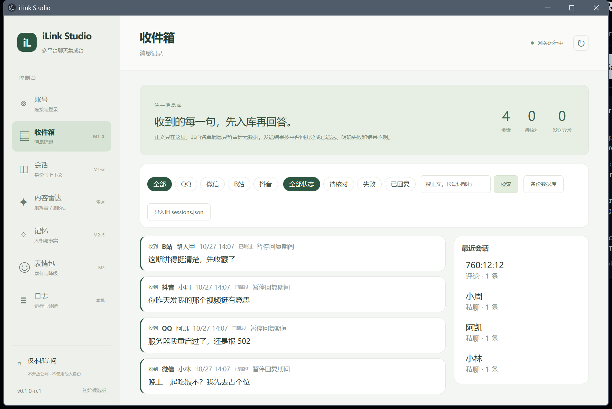
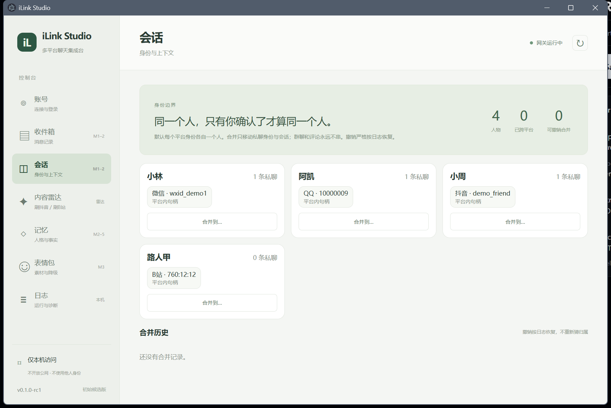

# iLink Studio · 多平台 AI 聊天集成台

把 QQ / 微信 / B站 / 抖音 归一成一个对话入口：平台上的消息先进本机消息库，再交给 Reasonix 回答，发回原平台。





## 它解决什么问题

- **一个窗口管四个平台**：QQ（NapCat / OneBot 11）、微信（官方 iLink Bot）、B站（私信 + 评论区）、抖音（MCP 后端）。账号、连接、发送三条状态分开看，不把「端口开着」当成在线，也不把「扫码成功」当成能发送。
- **先落库再回答**：所有消息先进本机 `mailbox.db`（WAL + 只向前迁移 + 迁移前备份），模型只是消费者，平台长轮询永远不等模型。
- **白名单决定回不回**：默认只回你点名的人；白名单外的消息只留审计元数据（`[privacy].record_all_bodies` 可改成本地保存正文，仍然不自动回复）。
- **记忆归你**：人格单例、跨平台会话窗口、长期事实带来源绑定与冻结保护；改人格只增版本，只影响新消息。
- **全本机**：控制面只绑 `127.0.0.1`，凭据进 Windows DPAPI 保险库，日志自动脱敏，数据目录可整体搬走。

> 截图为演示数据，账号与消息均属虚构。

```
QQ小号 ──NapCat(OneBot11)──┐
微信   ──官方 iLink Bot────┤
B站    ──私信+评论区API─────┼──► 网关 127.0.0.1:8787 ──┬─► reasonix（stdin）  ← 真·Reasonix
抖音   ──MCP 后端───────────┘                          └─► MCP server          ← 会话内主动发消息
                                    │
                                    └──► data/mailbox.db（消息 / 身份 / 会话 / 检查点 / outbox）
```

各平台的协议、真机验证与坑在下面各节；本文开头先讲**桌面应用的交付状态**。

## M0 / M1 / M2 / M3 / M4 / M5 交付

| 里程碑 | 内容 | 状态 |
| --- | --- | --- |
| M0 · 壳与登录 | Electron 主/预加载/托盘、独立网关生命周期、账号卡、登录 provider、DPAPI vault、微信双通道隔离 | ✅ 已验收 |
| M1 · 消息底座 | `mailbox.db`（WAL + 只向前迁移 + 迁移前备份）、单写者、消息/outbox 状态机、适配器检查点、旧 `sessions.json` 导入、收件箱与中文检索、备份/恢复 | ✅ 完成 |
| M2 · 身份与记忆 | person/identity/thread 边界、手动合并+撤销（预览、冲突检测）、人格单例与版本、长期事实注入/隔离、跨平台窗口与 L2 摘要、身份边界版本校验 | ✅ 完成 |
| M3 · 表情与能力 | 表情库（真实格式校验/去重/标签/停用/聊天图入库）、四平台能力矩阵、结构化表情引用、发图降级与原因记录 | ✅ 完成 |
| M4 · 可交付构建 | `[ui]/[memory]/[budget]/[stickers]/[logging]/[paths]` 配置、设置覆盖层（不动 config.toml）、首启向导（后端选择/模型名/真开机自启）、账号级通道启停、滚动日志与脱敏、诊断包、PyInstaller onedir 网关、Electron 发布数据目录 | ✅ 完成 |
| M5 · 完整候选版 | 长期事实抽取（严格 JSON、来源绑定、去重、冻结保护）、事实编辑、每日 token/费用预算、平台限速、needs_human、运行指标 | ✅ 完成，880 项测试全绿 |

M1～M5 的规矩（改代码前先看一眼，别破坏）：

- **落库先于模型**：适配器 `emit()` 只做过滤 + 落库 + 唤醒 worker，绝不让平台长轮询等模型。
- **一条路**：消息只有一个来源 `mailbox.db`；数据库打不开/写失败就显式报错并暂停 AI 处理，不退回 JSON。
- **同 thread 串行、跨 thread 有界并发**：靠租约的领取语句保证，不靠进程内锁。
- **发送结果只有 `sent`/`failed` 是确定的**：抛异常、崩溃一律 `unknown`，禁止自动重发，只能人工核对。
- **白名单外的正文默认不落库**：只留 `metadata_only` 审计元数据，库、FTS、导出、审计都查不到正文。把 `[privacy].record_all_bodies` 打开后正文只留在本机、收件箱能看见，但仍然不自动回复；只有昵称没有稳定 ID 的消息永远不存正文。
- **默认不合并任何人**：同昵称、头像像、模型猜都不算依据；合并要先预览影响范围再确认，撤销严格按 `merge_log` 恢复。
- **群聊 / 评论不共享私聊记忆**：一个群一个 thread、一个评论分支一个 thread，永远不进私聊事实。
- **人格单例、只向前**：四个平台读同一版 `persona`，改人格只增版本、只影响新消息，历史回复带旧版本号。
- **归属一变，过期回复作废**：`thread.boundary_version` 自增，生成中的回复保存前比对，不一致就丢弃并留审计。
- **表情只认库内 ID/名称**：带路径的 token 直接拒；未知/停用不静默删标记，换成可见说明并写审计。
- **不认识的能力不算支持**：`image_send` 只有明确 `supported` 才发图；`unknown`/`degraded`/`unsupported` 一律按文字降级，outbox 记 `requested=image`、`effective=text` 与原因。
- **配置只有覆盖层**：界面修改写 `data/ui-settings.json`，`config.toml` 永远只读；秘密只进保险库；只读段（paths/platforms/allowlist/server）改了直接拒。
- **预算在调用前**：每日 token/费用、平台每分钟、队列上限全部在模型调用前判断，超了标 skipped 并写审计，不先花钱再提示。

M2 的身份与记忆模型：

- 每个平台身份先各自一个 `person`；合并只移动私聊身份与会话，消息正文和平台消息 ID 不动，旧 thread 只留空壳。
- 归属不明的事实（没有明确来源身份）在合并时进 `quarantined`，撤销后也不自动恢复——宁可不用，不可乱用。
- 跨平台窗口默认 12 轮（24 条）；L2 摘要只在「换平台/距该平台上次 6 小时」时尝试，与窗口去重，上限 800 字，优先未完成的约定。
- 事实注入上限 12 条，按 `置信度 × 新鲜度 + 关键词命中` 排序；隔离/删除后下一次 prompt 立即不再包含。自动抽取在 M5，M2 只做读取、注入与纠错。

桌面入口：

```bash
npm run build:web          # 打包前端到 web/dist
npm start                  # Electron 拉起独立网关（127.0.0.1:8787）

python -m gateway.desktop --desktop --port 8787   # 不要 Electron，只跑桌面网关
python -m gateway.main --config config.toml       # 老的纯 CLI 网关（仍可用）
```

数据位置：`data/mailbox.db`（消息/身份/会话/检查点/outbox/persona/事实/合并日志）、`data/vault.db`（DPAPI 凭据）、
`data/backups/`（迁移前自动备份）。`data/sessions.json` 只作为**一次性导入源**，运行时不再读写。

M1 新增的接口（前缀 `/api/v1`，都要桌面会话凭据或 Bearer token）：

```
GET  /messages                 组合筛选 + (ingested_at,id) 游标；q= 走 FTS，1～2 字走精确子串
GET  /messages/{id}            正文、附件、状态、关联 outbox
POST /messages/{id}/confirm    待核对消息人工确认后才允许生成回复
GET  /conversations            会话列表（含待核对计数）
POST /outbox                   手写发送，202 + outbox_id，带幂等键
GET  /outbox/{id}              发送状态
POST /outbox/{id}/reconcile    mark_sent / ignore / resend（resend 是新任务、新幂等键）
POST /backup                   走 SQLite backup API，返回 integrity 结果
POST /imports/sessions         导入 data/sessions.json（可重复执行）
GET  /audit                    脱敏审计
```

M2 新增的接口（同样 `/api/v1`）：

```
GET  /persons                        人物列表（平台身份、私聊消息量、最近活动）
GET  /persons/{id}                   人物详情：事实、最近窗口、可合并候选
GET  /persons/{id}/candidates        合并候选（同昵称/跨平台只作提示，不自动合并）
POST /persons/{id}/merges            confirm=false 返回预览；confirm=true 才执行（写 merge_log）
GET  /merges                         合并历史
POST /merges/{id}/revert             按日志撤销（人工改动会报 409 冲突，不覆盖）
GET  /persona                       当前人格与版本
PUT  /persona                        保存为新版本（只影响新消息）
GET  /persona/versions               版本历史
GET  /memory-facts?person_id=        事实列表（status= 过滤，空值看全部）
PATCH /memory-facts/{id}             隔离/恢复/删除，或冻结/解冻
```

M3 新增的接口（同样 `/api/v1`）：

```
GET   /capabilities                  四平台能力矩阵（text/image/评论/主动私信，unknown 表示未确认）
GET   /stickers?q=&tag=&enabled=     表情列表（enabled=0 看全部）
POST  /stickers                      入库：{source_message_id} 从聊天图，或 {scan_directory:true} 扫 data/stickers
PATCH /stickers/{id}                 改名 / 换标签 / 停用启用（id 不变，模型引用不断）
```

M4 / M5 新增的接口（同样 `/api/v1`）：

```
GET   /bootstrap                     版本、sections、模型后端、首启状态与风险清单
POST  /onboarding                    三项确认（风险/数据位置/模型后端）+ 可选 Reasonix 可执行文件/模型名/开机自启 → 写覆盖层并热重载
PUT   /accounts/{id}/enabled         按账号启停通道（需登录并核对 UID；不满足条件返回 409 且说明缺哪一条）
GET   /napcat                        探测本机 NapCat：安装位置、真实 WebUI/OneBot 端口、是否在监听
GET   /allowlist                     当前白名单 + 最近发过消息的人（面板候选）
POST  /allowlist                     {platform, platform_uid} 加入；DELETE 移除，热生效
GET   /settings                      配置快照 + 凭据 configured 状态（不回显秘密）
PATCH /settings                      覆盖层原子写入 + 校验 + 热重载（memory/stickers/logging）
POST  /settings/secrets              秘密只写保险库
GET   /logs?lines=&level=&platform=  脱敏日志尾随
GET   /diagnostics                   版本/schema/队列/P95/token/费用/降级/DB 错误
POST  /diagnostics/export            导出诊断包（默认排除正文/附件/凭据）
PATCH /memory-facts/{id}             content / status / frozen（编辑有审计，改完立即影响下一次 prompt）
```

导入旧会话（源文件只读，重复导入不多行）：

```bash
python scripts/import_sessions.py                 # 默认 <数据目录>/sessions.json
python scripts/import_sessions.py --path 别的文件
```


## 当前状态（诚实版）

| 部分                 | 状态                                                                |
| ------------------ | ----------------------------------------------------------------- |
| 网关核心（模型/配置/路由/控制面） | ✅ 已完成，测试覆盖                                                        |
| QQ 适配器（OneBot 11）  | ✅ **已连真机**（QQ NT + NapCat，ws://127.0.0.1:3001）                    |
| 微信适配器（官方 iLink）    | ✅ **已真机验证**：扫码登录 → 长轮询收 → 带 context_token 回，闭环跑通（老 wxauto 路已废，见下） |
| B站适配器（私信 + @/评论区）  | ✅ **已真机验证**：收 @ → Reasonix 生成 → 回复评论，闭环跑通                         |
| B站「看视频」（元信息 + 字幕）  | ✅ 已真机验证元信息；字幕受本机 DNS 影响，见下                                        |
| DNS 兜底（DoH）        | ✅ 已真机验证：系统 DNS 拒解析时自动改问 DoH                                       |
| 抖音适配器（MCP 后端）    | ✅ **已真机验证**：刷一轮 36.2 秒出日报，证据不足不推生效（见下）                          |
| reasoning 后端       | ✅ **已端到端验证**（真实 CLI 调用成功，见「踩过的坑」）                                 |
| 图片收发               | ✅ 真机验证：QQ / B站 收发双向通；微信只给占位符、抖音私信读不到图（都会明确说看不到） |
| 表情包                | ✅ 真机验证：33 张素材入库；QQ 直发成功、B站私信发图成功；抖音/微信按能力降级为文字   |
| MCP server         | ✅ 已完成并注册进 `config.toml`，stdio 实测通过                                |

测试：`python -m unittest discover -s tests -t .` —— 880 项，全绿（2 项按环境跳过：wxauto 需微信 3.9.x、抖音真机需 playwright）。发布目录 `release/win-unpacked` 已按隔离数据目录实测，明细见 `docs/ACCEPTANCE.md`。

## 快速开始

```bash
cd ilink-studio

# 1. 配一份配置（不配就是全默认：没有平台被启用，只起控制面）
copy config.example.toml config.toml

# 2. 起网关
python -m gateway.main

# 3. 另开一个终端，测试控制面
curl http://127.0.0.1:8787/health

# 或者直接开桌面控制台（Electron 自己拉网关）
npm run build:web && npm start
```

token 自动生成在 `data/gateway-token.txt`，MCP server 和网关读同一个文件，不用手动配。
桌面模式用 `data/vault.db` 里的每会话凭据，普通浏览器打不开 `/api/v1`。

## 各平台怎么接

### QQ（推荐路径：官方机器人开放平台）

Reasonix 自带 `[bot.qq]`（app_id + QQ_BOT_APP_SECRET），走的是**官方**通道，零风控。  
另一条是本仓库的 OneBot 适配器：

```toml
[platforms.qq]
enabled = true
mode = "onebot"
onebot_ws = "ws://127.0.0.1:3001"
require_mention = true    # 群聊里必须 @ 我才理
```

需要先装 QQ NT 客户端 + [NapCatQQ](https://github.com/NapNeko/NapCatQQ)（11.4k⭐），  
在 NapCat 里开 WebSocket 服务端（默认 3001），然后**扫码登录**小号。  
不要把密码写进任何配置文件。

### 微信（官方 iLink 通道）

2026 年微信开放了个人 Bot API（微信 ClawBot，底层协议叫 **iLink**），域名是腾讯自家的  
`ilinkai.weixin.qq.com`，纯 HTTP/JSON，有正式的使用条款。**不注入客户端、不碰进程，  
正常使用不涉及封号**——跟当年那些 Hook DLL、逆向 iPad 协议的路子完全不是一回事。

```bash
# 1. 扫码登录（不碰密码，只认扫码）。凭据落到 data/wx-bot.json
python scripts/wx_login.py
```

扫码时要想清楚一件事：**这个码是用你的微信号去接成 bot**。别人私聊这个号，  
网关才收得到消息。想用小号就先把手机微信切到小号再扫。

登录成功后脚本会直接打印该填的白名单 id：

```toml
[allowlist]
wechat = ["xxxxx@im.wechat"]     # 脚本打印的那个「你的 id」
```

```toml
[platforms.wechat]
enabled = true
mode = "official"                  # official = iLink | wxauto = 老 UI 自动化
api_base = "https://ilinkai.weixin.qq.com"
skip_backlog = true                # 首次启动不把登录前的历史一次性喂给模型
```

凭据也可以走环境变量 `WEIXIN_BOT_TOKEN`（环境变量优先，文件兜底）。

#### 为什么不再用 wxauto

本机微信已经是 4.x，这条路是死的：

| 事实              | 证据                                                                  |
| --------------- | ------------------------------------------------------------------- |
| 客户端是 4.x        | 进程 `Weixin.exe`，窗口类名 `Qt51514QWindowIcon`（Qt 重构版）                   |
| wxauto 只认 3.9.x | 源码写死 `FindWindow(classname='WeChatMainWndForPC')`，那是微信 3.x 的 MFC 类名 |
| 官方也这么说          | wxauto 仓库 README 的环境表就写着「微信 3.9.X」                                  |

4.x 上 `WeChat()` 初始化根本找不到窗口。要跑就得把客户端降级到 3.9，而那条路仍然违反  
《微信个人账号使用规范》、有封号风险，可能连带主号。代码留在 `wechat.py`，只在  
`mode = "wxauto"` 时才走，默认不碰。

#### 协议上有三个坑（都改过一次实现）

1. **`context_token` 必须原样带回去。** 它是跟「对话窗口」绑定的，发消息不带就发不进  
   正确的会话。而这个 token 只从**收到的消息**里来——所以对方没说过话之前，主动去消息  
   可能失败。这是协议限制，不是 bug。
2. **`get_updates_buf` 游标必须落盘。** 它是增量游标，不存的话每次重启都从零开始，  
   会把历史消息当新消息重放一遍。存在 `data/wx-ilink-state.json`，跟 `context_token`  
   缓存放在一起。
3. **群聊按一对一处理。** 协议上有 `group_id` 字段，但官方实现回复时固定发给  
   `from_user_id`。这里照抄官方行为，不乱猜。

#### 已知限制

- 图片/语音/文件/视频**只收不发**，而且只以占位符（`[图片]` `[语音] 转写文字`）交给模型。  
  解密要 AES-128-ECB + CDN 上传，还没做——所以不会假装看得见图。
- 没有拉历史消息的接口，只有游标增量。
- 登录态过期时 `getupdates` 会返回 `errcode -14`，这时适配器会停下并提示重新扫码  
  （重启进程没用）。
- 腾讯保留限速、拦截、终止服务的权利，别把核心业务全押在这条通道上。

### B站（私信 + @ + 评论区）

这个适配器不是直播弹幕机器人，是「会私信、会回评论、会看视频」的那种。

```toml
[platforms.bilibili]
enabled = true
watch_private = true     # 收私信
watch_comment = true     # 收 @我的 和 收到的评论回复
notify_interval = 45.0   # 这两类通知没有推送，只能轮询；别调到 30 以下
```

四个凭据全走环境变量，**缺一个就只打日志、不收不发**：

| 变量                | 干什么用                                    |
| ----------------- | --------------------------------------- |
| `BILI_SESSDATA`   | 登录态本体，`Session` 和所有写接口都靠它               |
| `BILI_JCT`        | 就是 cookies 里的 `bili_jct`，每个写请求的 csrf 参数 |
| `BILI_DEDEUSERID` | 你自己的 uid，发消息时拼 `sender_uid`             |
| `BILI_BUVID3`     | 设备指纹，缺了 B站容易把请求当未登录设备                   |

怎么抠见下面「B站 cookie 怎么拿」。

**回评论要用的 `chat_id` 是 `oid:root:parent`**：  
`oid` 是视频 aid，`root` 是根评论 rpid，`parent` 是被回复那条的 rpid。  
网关收到 @/回复通知时会自动编好，不用手填。

**看视频**走 MCP 工具 `bili_video`，传 BV 号 / av 号 / 链接都行，  
返回标题、UP主、简介、时长、播放量 + CC 字幕全文。这个工具直连 B站公开接口，  
不需要 cookie，也不需要网关在跑。

#### 要用哪个 B站账号登录

**必须是一个和你本人分开的账号**（小号）。原因很硬：

- 网关是用 `BILI_DEDEUSERID` 那个号的登录态去收发消息的，机器人说的话就是这个号说的
- B站 API 层面**不允许给自己发私信**（库的 `Session.reply()` 里直接拦了）
- `Session` 默认 `exclude_self=True`，自己发出的消息根本不会作为事件回到网关

所以如果 `BILI_DEDEUSERID` 和 `[allowlist].bilibili` 填同一个 uid，会变成  
「自己发给自己 → 收不到 → 一条都不回」。

正确的关系是这样：

| 角色          | 是谁                    | 填在哪                             |
| ----------- | --------------------- | ------------------------------- |
| 机器人（干活的那个号） | 小号                    | `BILI_DEDEUSERID` + 另外三个 cookie |
| 你（下命令的人）    | 主号 `10000001` | `[allowlist].bilibili`          |

之后你在主号给小号发私信、或者在评论区 @ 小号，网关才动。

⚠️ 小号的现实门槛：新注册 / 低等级的 B站账号可能  
收不到陌生人私信、发评论要过验证码或绑定手机。真跑起来之前先用  
`python scripts/bili_smoke.py --live` 确认这个号能收能发。

### 刷B站（内容雷达，搬自 dsh-bili-scroll）

B 站这一条跟抖音那段**不是一回事**：抖音那边是「MCP 工具包直接干活」，B 站这边
上游是**值班层** —— 内置的 `bilibili-mcp` 只提供能力（搜索/字幕/评论/投弹幕/抽帧），
真正决定「挑什么、什么时候挑、说不说话」的是模型 + 一份 25KB 的值班章程。

我们把它拆成三层搬过来，UI 按本项目重做：

| 层 | 落在哪 |
| --- | --- |
| 能力层（34 个工具，原样委托） | `vendor/dsh-bili-scroll/vendor/bilibili-mcp/mcp_server.py`，经 `gateway/bili_mcp.py` 起 stdio MCP |
| 值班层（报告/判重/归档/配额/复核/转写） | `gateway/radar/duty.py`、`verify.py`、`transcribe.py` |
| 章程（判据/档位/文风/注入红线） | `gateway/prompts/bili_duty.md`，提炼后注入判断提示词 |

**判断依据是字幕原文**，这是它比抖音强的地方：抖音没有字幕轨，只能读观众反应；
B 站大量视频带 CC 字幕，它逐条读原文再判断，没字幕的演示类再抽故事板帧看画面。

开起来：

```toml
[platforms.bilibili]
enabled = true
radar = true
per_day = 5
dm_mode = "only"        # off = 只发公开评论 | only = 只发私信（默认）| both = 两边都发
comment_auto = false    # 自动评论并 @ 你：默认关
```

```bash
python -m gateway.main --config config.toml     # 或直接 npm start
# 再进「内容雷达 → B站」，点「刷一轮」
```

首次要两步：**装主依赖**（家目录建独立 venv，补 `mcp<2`；其余依赖本项目已有）→ **扫码登录**
（凭证落在 `data/bili-home/bili_credential.json`，不上传任何地方）。

几条硬规矩（都写进代码了，不是靠自觉）：

- **档位只有三个词**：值得看 / 可以看 / 不值当。写「值得看」**必须读过字幕或看过画面**，
  只有标题这类表层信息时最多「可以看」。
- **一天只有一份日报**：`data/bili-home/out/<日期>.md`，每条以 `### BV号` 开头 ——
  配额就是数这些行，所以「今天挑了几条」跟报告永远一致。
- **判重表读不出来时这一轮不发评论**：宁可少发，也不能把同一批视频反复推给同一批人。
- **自动评论默认关**，且走 `confirm` 闸：不带 confirm 只回草稿。B 站侧还有一道语感闸门
  （开头八股 / 跟自己历史太像 / 撞该视频热评），被拦就改写一次，再拦不发。
- **私信实测 490 字上限**（超了整条被拒，返回 21007）：所以在本地就拦，不发给 B 站去撞。
- **发出去 ≠ 公开可见**：发完会回头核一次，没查到就写「没查到」，不写成「没发出去」。

家目录布局（`data/bili-home/`）：

```
out/<日期>.md          日报（### BV号 + **档位**）
seen.md                判重表（挑了/跳过/评论）
digest/<年月>.md       归档：看过的每一条，含跳过的
reports/<BV>-<日期>.md 单条笔记
comments.md            已发评论台账（rpid 在这）
radar-settings.json    界面改的设置（config.toml 永远只读）
.venv/ .venv-asr/      主依赖与转写依赖（后者可选，约 1GB）
```

⚠️ **本地转写是可选的重依赖**：`yt-dlp` + `faster-whisper`（模型约 538MB）**不进安装包**，
开了才会下。不开也能用 —— 没字幕的视频会被跳过，报告末尾会写「因无字幕跳过 N 条」。

### B站 cookie 怎么拿

#### 推荐：跑登录助手（扫码，不用碰密码）

```bash
python scripts/bili_login.py --expect-uid 10000003
```

会弹出一个**独立的浏览器 profile**（跟你的日常浏览器完全隔离），你在里面扫码登录小号，  
脚本自动把四个 cookie 写进 `data/bili-cookies.json`（`data/` 已在 `.gitignore` 里），然后关掉窗口。

为什么不用自动化输密码：密码一旦过输入/日志/截图就有泄露面，扫码不需要它。  
为什么不用你现开的 Edge：Chromium 运行时会独占锁住 Cookies 数据库，别的进程读不了；  
而且 `SESSDATA` 是 HttpOnly，F12 控制台里的 `document.cookie` 也拿不到。

cookie 过期了重跑这条命令再扫一次码即可。登录助手留下的 profile 在 `data/bili-browser/`。

#### 备选：手动抠 + setx

1. Chrome / Edge 打开 [bilibili.com](https://www.bilibili.com) 并确保**已登录**
2. `F12` → `Application`（应用）→ 左侧 `Cookies` → `https://www.bilibili.com`
3. 在列表里找这四行，复制 `Value` 列：
   | Cookie 名                      | 填到环境变量            |
   | ----------------------------- | ----------------- |
   | `SESSDATA`                    | `BILI_SESSDATA`   |
   | `bili_jct`                    | `BILI_JCT`        |
   | `DedeUserID`                  | `BILI_DEDEUSERID` |
   | `buvid3`                      | `BILI_BUVID3`     |
   | 找不到 `buvid3` 就先随便点开一个视频页再回来看。 |                   |
4. 写进**当前用户**环境变量（不要写成系统级，也不需要管理员）：
   ```powershell
   setx BILI_SESSDATA "你的值"
   setx BILI_JCT      "你的值"
   setx BILI_DEDEUSERID "你的数字uid"
   setx BILI_BUVID3   "你的值"
   ```
   `setx` 只影响**之后新开**的终端，设完要重开终端才生效。  
   不想设环境变量也行 —— 直接把四个值写成 `data/bili-cookies.json`，  
   网关会读它（**环境变量优先，文件兜底**）。
5. 验证凭据真的通了：
   ```bash
   python scripts/bili_smoke.py --live
   ```
   ⚠️ `SESSDATA` 等于账号密码，**别贴进任何会提交的文件**。泄露了去 B站  
   「账号安全」里退出全部设备即可失效。

#### 已知环境坑：本机 DNS 拒解析 B站 域名

这台机器（江西移动 DNS `211.141.90.68`）会对 `api.bilibili.com`、`i0.hdslb.com`  
返回 `Query refused`，而且是**间歇性**的 —— 有时连、有时连续 5 次  
`getaddrinfo failed`。对外 53 端口也被拦，所以换公共 DNS 没用。

网关自带兜底：`gateway/doh.py` 给进程打一个 `socket.getaddrinfo` 补丁，  
只对 `*.bilibili.com` / `*.hdslb.com` / `*.bilicdn1.com` / `*.bilibili.tv`  
先问 DoH（默认 `https://223.5.5.5/resolve`，用 IP 直连所以它自己不需要 DNS），  
其它域名一律原样透传。TLS 的 SNI 仍按域名走，证书校验不受影响。

- 默认开启，`bilibili` 适配器初始化和 `bili_video` 工具都会装一次（幂等）
- 换 DoH 端点：设 `ILINK_DOH`（`1.1.1.1` / `8.8.8.8` 在这台机器上不通，别用）
- 效果：`socket.getaddrinfo("api.bilibili.com", 443)` → 走 DoH → `112.13.92.199`

只在 DoH 也拿不到结果时才回退系统 DNS，所以坏 DNS 环境下仍然会偶尔失败重连。

### 抖音（MCP 后端，dsh-douyin-scroll）

```toml
[platforms.douyin]
enabled = true
mode = "mcp"                     # 走 dsh-douyin-scroll 的 MCP server（不再读 DOM）
home_dir = ""                    # 留空 = <数据目录>/douyin-home：Cookie / 记忆 / 报告都在这
node_path = ""                   # 留空 = PATH 里的 node（要求 >= 22）
poll_interval = 30
max_conversations = 5
```

需要系统装 **Node ≥ 22**：发布版不自带 Node，缺了界面会明确报出路径与版本，不静默失败。
插件本体在 `vendor/dsh-douyin-scroll`（MIT，上游 `NEWJO123/dsh-douyin-scroll`），
随包进 `resources/douyin-mcp`；协议实测与工具清单见 `docs/DOUYIN-MCP.md`。

**RPA 已退役**：`PlaywrightDriver` 与全部 DOM 选择器已删除，`mode = "rpa"` 不再有效。
DOM 会随改版失效、页面还会被风控换成验证码页，线上反复出现「私信浮层打不开」
「这轮和上一轮窗口对不上」。下面 383 行起的 DOM 细节与「真机上撞出来的 7 条」
属于 RPA 时代的历史记录，**已经失效**，只留作背景，别再照着它改代码。

**能做什么**

| 能力                    | 状态                                         |
| --------------------- | ------------------------------------------ |
| 收私信 → 回私信             | ✅ 真机跑通：会话列表、消息流、方向判定、真实发送（对方已收到）           |
| 看视频（标题/作者/描述/前 N 条评论） | ✅ MCP 工具 `douyin_video`，经控制面 `POST /video` |
| 回评论区                  | ✅ 真机跑通：@ 我 → 读 `douyin_notices` 判楼根 → 回复（2026-10-27 首条 `sent`） |

**（历史，已失效）真机上撞出来的 7 条**（RPA 时代记录，仅作背景）：

1. `goto(wait_until="domcontentloaded")` 必然 30 秒超时 —— 抖音先抛 JS 挑战壳，  
   那个事件永远不触发。只能 `commit` + 自己等；而且连 `commit` 都可能被吊住，  
   所以外面还套了一层硬超时。旧版本就是卡死在这一行，从来没跑通过一次。
2. playwright 默认参数拿到的是**只设了 title 的挑战壳**（body 空、7 个 cookie）。  
   补真 UA、`zh-CN`、`Asia/Shanghai`、1440×900 并抹掉 `navigator.webdriver`  
   才落到真页面（登录后 63 个 cookie）。参数在 `douyin.STEALTH_ARGS`，别删。
3. 抖音页面**常驻一个隐藏的 captcha 容器**。判断「是不是验证码页」必须看可见性，  
   只查元素存在会永远误报 —— 表现是轮询一直跳过、一条消息都收不到。
4. **私信不是一个页面，是首页上的浮层**：点 `[data-e2e='im-entry']` 展开  
   `[data-e2e='im-dialog']`，**URL 不变**（还是 `/jingxuan`）。  
   所以「URL 里有 message 才算消息页」这种判断是错的。
5. 浮层没展开时 `[data-e2e='conversation-item']` 在 DOM 里存在但尺寸为 0，  
   直接 click 会报 `element is not visible`。
6. 私信编辑器里 **Enter 是换行不是发送** —— 按回车不报错，但消息根本没发出去。  
   发送必须点 `.messageMsgInputpublishBtn`（32×32 svg，带 `e2e-send-msg-btn` 标记）。  
   所以 `send()` 用「发送后输入框有没有被清空」来确认，而不是「没抛异常就算成功」。
7. 切会话要**先点标题栏返回箭头回到列表**，再点目标会话：停在详情页时直接点列表项，  
   真机上经常被吞（点了不报错但不切换）；而且消息列表是懒加载的，  
   滚动一下多加载几条会让「内容有没有变」这个判据失真。

**私信 DOM（真机 dump 的当前值；改版时只改 `[platforms.douyin.selectors]`，不用动代码）**

```
会话列表  [data-e2e='conversation-item']
  标题    .conversationConversationItemtitle
  时间    .ConversationItemTagNextToTitletimeStr
  预览    .ConversationItemDescwrapper
消息列表  .messageMessageListlist
  气泡    .messageMessageBoxmessageBox
  正文    .messageMessageBoxcontentBox
输入框    div.messageEditorinputArea      （placeholder="发送消息"）
发送按钮  .messageMsgInputpublishBtn      （32×32 svg，带 e2e-send-msg-btn）
```

**消息方向怎么判**：**不能按位置判** —— 真机 dump 出来每条消息盒都是整行容器  
（`x=1093`、`width=325`），中心恒等于列表中线，左右分不开；一开始就是按位置判的，  
结果每条消息都被当成对方发的。正确依据是 DOM 自带标记：  
自己发的消息里有 `messageMessageBoxisFromMe` / `MessageBoxContentisFromMe`，对方的没有。  
自己发的不会回灌给模型，否则会自问自答。

**首轮不回放**：启动后第一次扫描只把已有消息登记成「已见」，不上报 ——  
否则第一次运行会把整段历史聊天一次性喂给模型。


**看视频**：

```
MCP 工具 douyin_video → POST /video → Router.video_brief → 网关那个已登录的浏览器
```

传 aweme_id 或 `https://www.douyin.com/video/<id>` 都行，返回标题、作者、描述、  
前 N 条评论。抖音要登录态，所以必须借网关的浏览器 —— 网关没起会明确报错，  
不会假装看到了。

**改版或换账号后重新探结构**：

```bash
python scripts/douyin_probe.py --wait-login 1800 --video auto
```

弹独立 Chromium（profile 在 `data/douyin-profile/`，与日常浏览器隔离），  
过验证码 + 扫码登录后自动把私信 / 视频页的真实结构写进 `data/douyin-dom.json`。  
全程只读：不点发送、不点赞、不关注。

**已知限制**：

- **风控会升级成全站挑战壳**（本次联调就撞上了）：同一台机器连续跑几次自动化之后，  
  连私信页直达 URL 也只返回挑战壳 —— URL 是对的、`cookie` 从 69 掉到 57、  
  `[data-e2e='im-entry']` 15 秒都不出现。这时只能人工过验证或等冷却。  
  这也是 README 开头就把抖音标成「预期最低」的原因
- 切会话**必须先回列表再点**（见上第 7 条）：停在详情页时直接点列表项会被吞。  
  代码的判断是「宁可漏、不可串」—— 确认不了切换就跳过该会话，绝不把 A 的消息当成 B 的
- `send()` 的成功判定是「输入框被清空 + 消息流里能回读到这条」，  
  单看没抛异常不作数（Enter 换行就这么骗过一次）
- 评论项内部 class 是随机哈希（`Eh0a5CD4`、`xUjvrHoz`…），每次发版都可能变；  
  只有 `data-e2e` 和带语义前缀的 `comment-input-*` 能依赖
- 每轮只扫最近 `max_conversations` 个会话（默认 5）：全量遍历慢，而且会把会话全标已读
- 风控随时可能升级（验证码 / 滑块），被拦时轮询会跳过并打日志，需要人工过一次
- 「回复某条具体评论」没做：现在评论是直接发在视频下，不会点别人的「回复」

要正经长期用抖音，还是去申请开放平台资质。

## 图片与表情包

各平台的真实边界（2026-10-27 真机核对，`/api/v1/capabilities` 与这里一致）：

| 平台 | 收图 | 发表情 | 说明 |
| --- | --- | --- | --- |
| QQ | ✅ | ✅ | 双向都通；图片落 `workspace/inbox/` 给模型读 |
| B站 | ✅ | ✅ | 收的是 CDN url（会下载），发走 `EventType.PICTURE`，回 `msg_key` 才算成 |
| 微信 iLink | ⚠️ 占位符 | ❌ | 需 AES-128-ECB + CDN 上传，未实现；模型只看到 `[图片]` |
| 抖音 | ⚠️ 读不到 | ❌ | `im_read` 无图片字段；非文本消息会变成「看不到内容」的提示，不静默吞 |

**收图**：QQ 发来的图片会落到工作区 `data/im-workspace/inbox/`，prompt 里给模型相对路径，  
它自己读文件看。读得到就描述，读不到会直说看不到（不装懂）。

**发表情包**：把图片丢进 `data/stickers/`，**文件名就是语义标签**（`笑.png`、`无语.gif`）。  
网关启动时扫目录，把清单塞进 prompt，模型在回复末尾写 `[[表情:无语]]`，  
网关剥掉标记、发文字、再单独发那张图。

```
data/stickers/笑.png     →  模型写 [[表情:笑]]
data/stickers/无语.gif   →  模型写 [[表情:无语]]
```

名字决定模型什么时候用它。`笑` `无语` 是好名字，`IMG_20261025` 模型永远不会选。  
改完目录要重启网关才重新扫描。

## 踩过的坑（都是真机上撞出来的）

**1. `reasonix -p <多行prompt>` 在 Windows 上会被截断。**  
npm 装出来的 `reasonix` 是 `.cmd` shim，必须经 `cmd.exe` 启动，而 `cmd.exe` 会把参数  
截断在第一个换行处。结果模型只收到 preamble 第一句，看不到真正的问题——表现就是  
**答非所问**（问「你会发表情包吗」，回「我在呢，主人，有什么要聊的」）。  
改用 stdin（`reasonix run` 读 stdin）之后才完整送达。

**2. `--max-steps` 给多了会灌进来一整套 agent 上下文。**  
同样一句闲聊，`--max-steps 3` 时输入 **78,089 tokens**、耗时 33 秒、还答非所问；  
`--max-steps 1` 只要 **10,704 tokens**、10 秒、正面回答问题。  
所以纯文字消息一律给 1 轮；**只有带图时**才放开到 3 轮（读文件看图需要工具轮次）。

**3. 系统 DNS 挂了也不影响跑，只要有代理。**  
本机实测：IPv6 DNS `fe80::1` 返回 Query refused，运营商 DNS 的 UDP 53 全部超时，  
但 HTTPS 是通的。Reasonix 侧配 `[network] proxy_mode = "custom"` 指向本地代理即可。  
注意这只救了走代理的程序——网关自己下载外网图片仍然会失败，所以收图优先用本地缓存路径。

## 代价，提前说清楚

- **延迟**：纯文字消息约 10 秒（`--max-steps 1`）；带图要看图，20-40 秒。手机上就是"发一句等十秒"。
- **成本**：纯文字约 10k token/条、$0.0005；带图翻倍。
- **上下文**：靠网关侧 `SessionStore` 拼最近 12 轮进 prompt，不是模型原生记忆。

## 安全约束

- 控制面**只允许绑 loopback**（`server.py` 里有硬校验，绑 `0.0.0.0` 直接抛异常）
- `/send` 需要 Bearer token，token 存 `data/gateway-token.txt`（0600）
- 所有凭据只从环境变量读，配置文件里只有变量名
- 白名单默认开启：`[allowlist]` 里只填你自己的账号，别人说话网关不理
- 白名单决定「回不回复」，不决定「存不存正文」：`[privacy].record_all_bodies = false`（默认）时非白名单消息只留审计元数据；改成 `true` 就把正文保存在本机，收件箱能看见对方说了什么，但依然不会自动回复。临时看一眼再关回去即可，不用改白名单。

## 打包（M4）

```bash
npm run build:web        # 前端 → web/dist
npm run build:gateway    # PyInstaller onedir → dist/gateway/gateway.exe
npx electron-builder --dir   # 组装发布目录 → release/win-unpacked
```

发布模式数据目录是 `%LOCALAPPDATA%\iLink Studio\data`（日志在 `..\logs`），
与 `gateway/paths.py` 一致；网关二进制不依赖系统 Python，已实测在非项目 cwd 下可启动。

0.1.0-rc1 发布目录实测结论（隔离数据目录 + 独立端口，全部 `ILINK_DATA_DIR` 覆盖）：

- 在 `C:\Windows\Temp` 下、PATH 只留 `C:\Windows\System32;C:\Windows`（无 Python/Node）可启动，`/healthz` 返回 `0.1.0-rc1`。
- 六区与首启向导真机可用：向导可选 Reasonix 可执行文件、填模型名、写自启；确认后回到控制台。
- 网关是后台服务：强杀 UI 后 `gateway.exe` 继续跑，重启应用读 `runtime.json` 重接管，`gateway.exe` 始终只有一个。
- 主动退出（托盘或 UI 桥接）会先让网关优雅结束（`gateway exit: code=0`）再关应用。
- 冷启动：首次 8.24s（冷缓存），其后 1.22–1.24s；首次未达 5 秒目标，待目标机复测。

## 代码结构

```
gateway/
├── models.py            统一消息模型（Inbound/Outbound/PromptContext/session_key）
├── config.py            TOML 配置
├── db.py                SQLite 底座：pragmas、只向前迁移、迁移前备份、integrity
├── schema.py            v1→v3 迁移（消息/身份记忆/表情库，统一编号、只向前）
├── mailbox.py           唯一业务数据入口：单写者线程、落库、租约、outbox、检查点、检索、导入、备份
├── checkpoint.py        适配器检查点（游标/窗口状态；不接受凭据字段）
├── router.py            入站流水线：过滤 → 落库 → worker → 模型 → outbox → 发送结果
├── brain.py             reasonix CLI 调用；prompt 装配交给 prompt.py
├── prompt.py            PRD §8.1 的 prompt 排版与预算裁剪
├── memory.py            人格版本、长期事实、跨平台窗口与 L2 摘要
├── identity.py          人物合并/预览/撤销（merge_log + 边界版本）
├── stickers.py          表情库：格式校验、去重、标签、引用解析、聊天图入库
├── settings.py          界面设置覆盖层（原子写入、校验、秘密只经保险库）
├── budget.py            每日预算与平台限速闸门（调用前判断）
├── facts.py             长期事实抽取：严格 JSON、来源绑定、去重
├── logs.py              滚动日志 + 写入前脱敏 + 尾随 + 诊断包
├── metrics.py           计数、P50/P95、token 估算与费用
├── importer.py          旧 sessions.json 一次性导入（确定性 dedup_key）
├── api.py               控制面业务接口（账号/登录/消息/outbox/备份/审计）
├── server.py            HTTP 传输层（loopback + Host/Origin/Bearer + CSP）
├── accounts.py          账号槽位与三种健康状态
├── vault.py             DPAPI 保险库（凭据、context_token）
├── paths.py             资源与可写数据路径（开发 data/，发布 %LOCALAPPDATA%）
├── mcp_server.py        MCP server（stdio JSON-RPC）
├── doh.py               DNS 兜底：B站域名解析失败时改问 DoH
├── token.py             共享 token
├── main.py              纯 CLI 网关入口
├── desktop.py           桌面网关入口（Electron 托管，独立进程）
└── adapters/
    ├── base.py          适配器抽象 + 检查点工厂
    ├── qq.py            OneBot 11 over WebSocket
    ├── wechat.py        wxauto 老路（只认微信 3.9.x；build() 按 mode 分派）
    ├── wechat_ilink.py  微信官方 iLink 通道（默认走这条）
    ├── bilibili.py      私信监听 + @/评论轮询 + 看视频 + 发送
    └── douyin.py        MCP 后端（dsh-douyin-scroll；13 个工具 + 发送闸）
```

## 排查

```bash
# 看 CLI 通不通（dry run 不花钱）
python scripts/smoke_brain.py
# 真调一轮（会产生少量费用）
python scripts/smoke_brain.py --live
```

## 许可

MIT，见 [LICENSE](LICENSE)。
